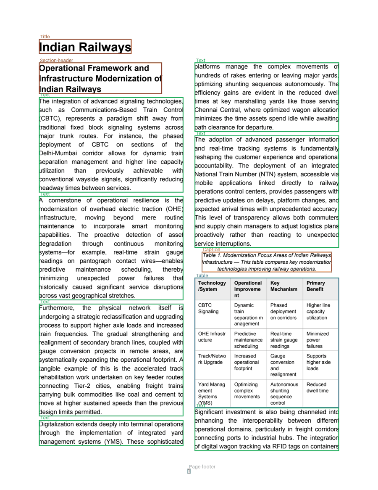

# Synthetic Document Factory

**Generate labelled document-layout datasets with a local LLM: PDFs, page images and exact bounding boxes in COCO
and YOLO format.**

Training a layout detection model (YOLO, DETR, LayoutLMv3) needs pages where every title, paragraph, list, table
and figure is boxed and labelled. Labelling by hand is slow and expensive. This tool writes the documents itself with
any [Ollama](https://ollama.com) model, lays them out in different styles, and records where every element lands
*while the PDF is being drawn*, so the labels are exact instead of guessed.



## Features

- **Real content.** A local LLM writes an outline, the sections, tables and charts. No API key, no cost.
- **Exact boxes.** Taken from the PDF renderer itself, including paragraphs and tables that continue on the next
  page or column. Tests read the text back from inside every box to prove it.
- **DocLayNet labels.** The same 11 category names and ids as [DocLayNet](https://github.com/DS4SD/DocLayNet), so
  the output can be mixed with it.
- **Layout variety.** One or two columns, Times or Helvetica, four font sizes, three margins, A4 or Letter, running
  headers, numbered or plain headings, justified or left-aligned text.
- **Free augmentation.** `--variants 5` renders the same text in 5 different layouts with no extra LLM calls.
- **Page targeting.** Aims for the page count you ask for, adding or trimming text until it fits.
- **Real charts.** Bar, line, area and pie charts drawn with matplotlib.

## Quick start

**1. Install Ollama** from [ollama.com/download](https://ollama.com/download) and pull a model:

```bash
ollama pull mistral
```

**2. Set up the project:**

```bash
python3 -m venv .venv
.venv/bin/pip install -r requirements.txt
```

**3. (Optional) choose the model** in a `.env` file. Without it, `mistral:latest` on `localhost:11434` is used.

```
OLLAMA_URL=http://localhost:11434
OLLAMA_MODEL=llama3:latest
```

**4. Generate a dataset:**

```bash
.venv/bin/python main.py --topic "Indian Railways" --pages 3 --tables 1 --charts 1 --variants 3 --preview
```

Run `.venv/bin/python main.py` with no flags to be asked for the topic, pages, tables and charts instead.

## Options

| Flag | Meaning | Default |
| --- | --- | --- |
| `--topic` | What the document is about | asked |
| `--pages` | Target number of pages (1–200) | asked |
| `--tables` | Tables in the document (0–5) | asked |
| `--charts` | Charts in the document (0–5) | asked |
| `--layout` | `single` column, `double` column, or `random` per variant | `random` |
| `--variants` | Render the same text in this many layouts | `1` |
| `--seed` | Make the random layouts repeatable | none |
| `--dpi` | Page image resolution | `150` |
| `--preview` | Also save every page with its boxes drawn on | off |

## Output

```
output/indian_railways/
├── pdf/indian_railways_1.pdf          one PDF per layout variant
├── images/indian_railways_1_p01.png   one image per page
├── labels/indian_railways_1_p01.txt   YOLO boxes: class cx cy w h (0–1)
├── annotations.json                   COCO boxes in pixels, plus each element's text
├── data.yaml                          ready for YOLO training
├── content.json                       the generated text, tables and chart data
└── preview/indian_railways_1_p01.png  pages with boxes drawn on (--preview)
```

Each COCO annotation also stores the text inside the box, which is useful for text-aware models such as LayoutLM.

### Labels

| Id | Label | Marks |
| --- | --- | --- |
| 1 | Caption | "Table 1 …" / "Figure 1 …" captions |
| 2 | Footnote | not generated, kept so ids match DocLayNet |
| 3 | Formula | not generated, kept so ids match DocLayNet |
| 4 | List-item | each bullet or numbered point |
| 5 | Page-footer | page number |
| 6 | Page-header | running header with the document title |
| 7 | Picture | charts |
| 8 | Section-header | section and sub-section headings |
| 9 | Table | tables (each piece, if split across pages) |
| 10 | Text | body paragraphs (each piece, if split) |
| 11 | Title | document title |

YOLO class numbers are the id minus one.

## Train a detector

```bash
pip install ultralytics
yolo detect train data=output/indian_railways/data.yaml model=yolov8n.pt imgsz=1024 epochs=50
```

`data.yaml` points both `train` and `val` at the same images. Split them into separate folders before real training.

## How it works

```
Topic + page count
  → Outline      the LLM plans the section titles
  → Write        two LLM calls per section, so small models reach the word target
  → Polish       weak paragraphs (generic openers, filler endings, repeats) are rewritten
  → Visuals      the LLM returns table and chart data as JSON; charts are drawn with matplotlib
  → Render       reportlab lays out the PDF; a tracking frame records every element's box
  → Fit pages    add or trim text and re-render until the page count is right
  → Variants     re-render the same text in new random layouts
  → Export       page images, YOLO labels, COCO annotations and data.yaml
```

## Project structure

```
.
├── main.py            run this: content pipeline, page-count loop, variants, export
├── core/llm.py        talks to Ollama: outline, sections, rewrites, tables, charts
├── core/assembler.py  layout styles, PDF rendering and box tracking
├── core/dataset.py    page images, COCO and YOLO export
└── tests/             test suite (runs without Ollama)
```

## Tests

```bash
.venv/bin/pip install -r requirements-dev.txt
.venv/bin/pytest
```

## Limits

- English (Latin-alphabet) text only, because the PDFs use the built-in PDF fonts.
- Each document takes several minutes on a laptop, since a local LLM writes every section. Use `--variants` to get
  more labelled pages from the same text.

## License

Released under the MIT License (see `LICENSE`).
